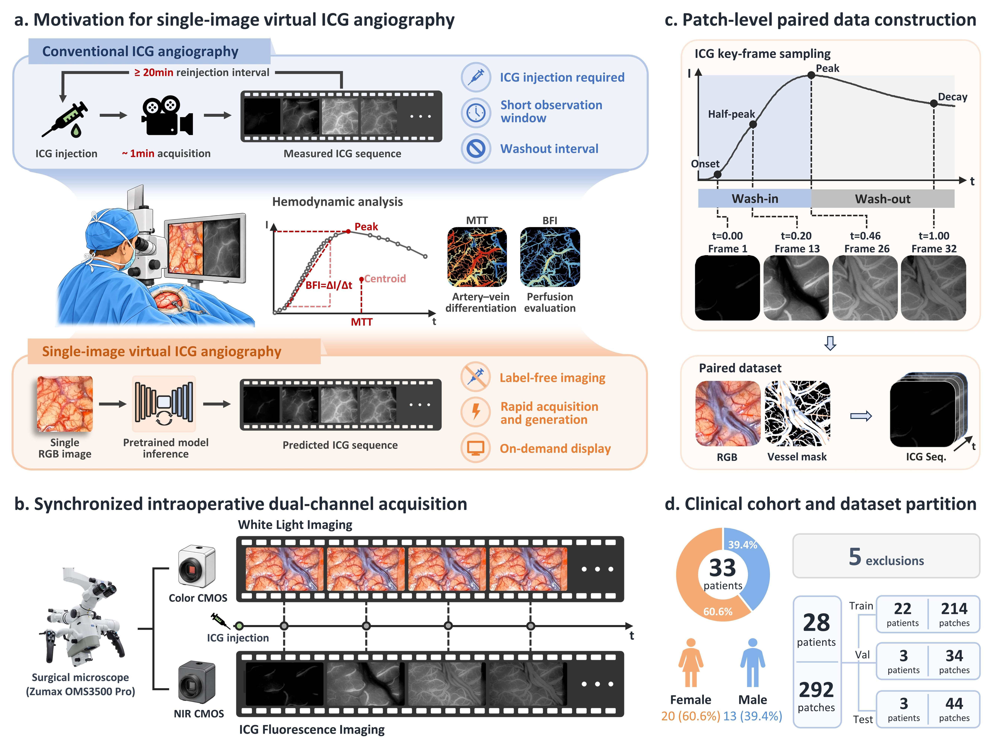
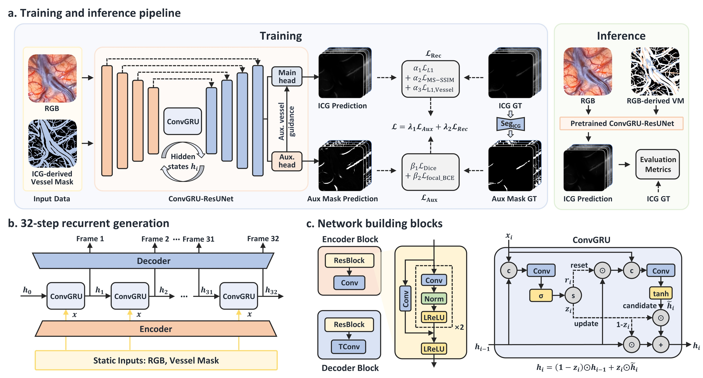

# WhiteLight2ICGVideo

Core ConvGRU–ResUNet implementation accompanying the manuscript **Single optical snapshot encodes local human cerebral vascular dynamics**.

**Yan Shi, Yuhao Sun, Liuguan Bian and Peng Miao**  
Shanghai Jiao Tong University and Ruijin Hospital, Shanghai, China.

## Overview

Can a single white-light image of the exposed human cortex support prediction of local vascular filling dynamics? This study investigates that question using paired intraoperative white-light RGB images and indocyanine green (ICG) fluorescence recordings. The model generates an ordered 32-frame fluorescence sequence from one baseline RGB image and a vessel mask derived from that same image.



*Paper overview. Clinical motivation, synchronized RGB–ICG acquisition, paired 32-frame dataset construction, and patient-level dataset partitioning for single-image virtual ICG angiography.*

The generator combines a residual U-Net encoder–decoder with a bottleneck convolutional gated recurrent unit (ConvGRU). Static image features condition a recurrent hidden state, initialized to zero and updated over 32 steps. An auxiliary vessel branch provides structural supervision and gates the fluorescence reconstruction features. The RGB-derived mask is a representation of the same observation, not an additional patient measurement.



*Training uses paired RGB/ICG data and vessel supervision; inference uses a single RGB image and its RGB-derived vessel mask. The recurrent model generates 32 fluorescence frames without measured ICG frames or patient-specific timestamps as inputs.*

The manuscript studies 28 patients with 292 paired cortical patch sequences, split by patient into training (22 patients, 214 patches), validation (3 patients, 34 patches) and testing (3 patients, 44 patches). Evaluation examines sequence reconstruction, local fluorescence-derived parameters—T10, sampled fluorescence temporal center (MTT), peak intensity and blood flow index (BFI)—and relative vascular filling order. Half-credit order consistency assigns 0.5 to predicted ties and is interpreted alongside the predicted tie rate.

Predictions describe fluorescence trajectories on a normalized progression coordinate, not patient-specific physical acquisition times or direct measurements of absolute blood flow. This is research software, not a validated clinical decision tool.

## What this code contains

This package contains the **core sequence generator and its training/inference pipeline**, rather than the complete analysis repository. The default configuration corresponds to the no-time Full model. Input switches also support removing RGB or the explicit vessel mask.

```text
Code/
├── assets/
│   ├── paper_overview.jpg                  Paper overview
│   └── framework.png                       ConvGRU–ResUNet framework
├── configs/convgru_resunet.yaml            Default training configuration
├── train.py                               Training, validation and checkpoint selection
├── predict.py                             Standalone RGB + vessel-mask inference
├── infer_patch.py                         Original-format patch inference and evaluation
├── smoke_test.py                          Synthetic forward/backward and checkpoint test
├── wlicgv/
│   ├── models.py                          Residual U-Net, ConvGRU and gated output heads
│   ├── data.py                            Paired patch and frame-metadata loading
│   ├── losses.py                          Reconstruction and auxiliary vessel losses
│   ├── time_templates.py                  Time-coordinate compatibility utilities
│   └── utils.py                           Splits, logging and previews
├── eval/                                  Image/video metric helpers
├── notebook/summarize_experiment_metrics_by_split.py
├── scripts/run_train.bash
├── scripts/run_inference.bash
├── requirements.txt
└── requirements-eval.txt
```

RGB2Vessel segmenter training, baseline generators, population-template construction and the full ROI/hemodynamic analysis workflow are **not included**. Standalone inference expects a precomputed RGB-derived vessel mask. Pretrained checkpoints are not bundled in this directory.

## Installation and quick check

Use Python 3.10 or later for a new environment. Install a PyTorch build suitable for your CPU/CUDA setup, then install the dependencies:

```bash
python -m pip install -r requirements.txt
python smoke_test.py
```

Run these commands from the `Code` directory. The smoke test requires no clinical data or pretrained weights. It uses a reduced-width model to test the actual training loss, backward propagation, an AdamW update, a 32-step recurrent rollout, and checkpoint save/reload. It is a connectivity test, not a reproduction of the trained model's performance.

For LPIPS and FVD evaluation, also install:

```bash
python -m pip install -r requirements-eval.txt
```

These metrics require pretrained feature-network weights, which may need downloading or an existing cache. The dependency lists specify minimum requirements; they are not a lockfile for the original training environment.

## Generate a sequence from an RGB image

Provide a trusted no-time checkpoint, one RGB image and its corresponding RGB-derived binary vessel mask. For the accompanying renamed patch export, the inputs are organized as:

```text
Data/
└── S1_01/
    ├── S1_01_rgb.png
    ├── S1_01_rgb_vessel_mask.png
    └── icg_keyframe_patches/
        └── Intensity_step_sample/          Reference frames; not used by predict.py
```

From `Code`, run:

```bash
python predict.py --checkpoint "/path/to/best.pt" --rgb "../Data/S1_01/S1_01_rgb.png" --mask "../Data/S1_01/S1_01_rgb_vessel_mask.png" --out-dir "outputs/S1_01"
```

Replace `/path/to/best.pt` with the actual checkpoint path. The configuration embedded in the checkpoint defines the model and input resolution. If it is missing, supply a matching configuration with `--config`.

The default output consists of 32 predicted fluorescence PNGs in `pred/`, auxiliary vessel-mask PNGs in `aux_mask/`, and a `prediction.json` provenance record. Output directories must be empty to avoid overwriting results. Use `--device cpu` to force CPU inference or `--mask-kind probability` for a vessel probability map instead of a binary mask.

`predict.py` does not read the reference ICG sequence or compute GT-based metrics. Its PNGs are 8-bit visualizations. Output positions index recurrent rollout steps; they should not be interpreted as uniformly spaced physical timestamps. In the manuscript's functional evaluation, predicted frames receive the training-set mean normalized coordinate after generation, while reference parameters use each case's own normalized coordinates.

## Train the model

Edit `configs/convgru_resunet.yaml` to set `data.root` and `data.rgb2vessel_root` for your environment. Training uses the original paired-patch layout, including vessel supervision and frame metadata. The reduced, renamed `Data/S1_01` export above supports standalone inference but is **not** a complete replacement for the training dataset.

```bash
python train.py --config configs/convgru_resunet.yaml
```

Or, with Git Bash:

```bash
bash scripts/run_train.bash
```

The supplied configuration uses 256 × 256 inputs, 32-frame sequences, base feature width 32, a 512-channel ConvGRU bottleneck, and dual fluorescence/vessel outputs. Training defaults are AdamW with learning rate `2e-4`, betas `(0.5, 0.999)`, zero weight decay, batch size 1, 60 epochs, seed 2026 and automatic mixed precision when available. The best checkpoint is selected by maximum validation sequence SSIM. New runs are saved under the local `experiments/` directory.

Training uses ICG-derived global masks as structural input and reconstruction support, with key-frame vessel masks for auxiliary supervision. Deployment instead supplies RGB-derived masks. The actual enabled loss terms and weights are specified by the YAML and `train.py`; disabled configuration entries do not contribute to the objective.

Resume an interrupted run with:

```bash
python train.py --config configs/convgru_resunet.yaml --resume "experiments/<run>/checkpoints/latest.pt"
```

Historical checkpoints may use `convgru_unet`, `nnunet` or `ConvGRUNNUNet` as configuration/class names. Compatibility aliases are retained; the implemented backbone is a residual U-Net and does not require the nnU-Net software package.

## Batch inference and reconstruction metrics

For an experiment using the original dataset layout, the launcher below evaluates the test split with the best checkpoint and RGB2Vessel binary-mask inputs, then summarizes reconstruction metrics:

```bash
bash scripts/run_inference.bash "/path/to/experiments/<run>" "./outputs/best_rgb2vessel_mask"
```

The experiment directory must contain the matching configuration, split information and `checkpoints/best.pt`, with accessible dataset paths. The second argument specifies a new empty output directory. The launcher uses Git Bash on Windows or Bash on Linux/macOS. Running it without arguments uses the original local experiment path configured in the script.

Ground-truth ICG frames are used for evaluation, not as inference inputs. The legacy `eval/cal_fvd.py` interface calculates patch-level FVD; it is not the manuscript's pooled cohort-level FVD calculation. The full functional-parameter, patient-level ROI and half-credit ordering analyses require the separate analysis workflow and are not reproduced by this launcher.

## Verification

The extracted core was checked against the original Full-model checkpoint with strict parameter loading. Four consecutive recurrent predictions matched the original implementation exactly in the CPU test. Synthetic loss/backward/optimizer and checkpoint round-trip tests passed, and standalone inference generated 32 frames at 256 × 256 from a real RGB/mask pair. Details are recorded in `VERIFICATION.json`; file checksums are listed in `MANIFEST.json`.

## Manuscript and contact

**Single optical snapshot encodes local human cerebral vascular dynamics**  
Yan Shi, Yuhao Sun, Liuguan Bian and Peng Miao.

Correspondence: **Peng Miao**, [pengmiao@sjtu.edu.cn](mailto:pengmiao@sjtu.edu.cn).

Clinical images and recordings remain subject to the applicable participant consent and institutional approvals. File renaming alone does not establish permission for public data release.
